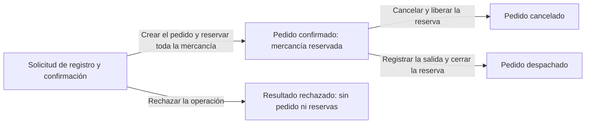

# DDD estratégico de Abasto

El dominio es la gestión operativa de pedidos e inventario de distribuidoras que venden alimentos e insumos a restaurantes.

La promesa central es que **ventas pueda comprometer mercancía disponible y bodega pueda conocer qué está reservado, qué se liberó y qué salió**. Abasto mantiene el registro de existencias sobre el que se toman esas decisiones.

Los empleados utilizan la aplicación. Los restaurantes se comunican con los vendedores, quienes registran y gestionan sus pedidos. Cada distribuidora conserva sus propios productos, compradores, existencias, pedidos y usuarios autorizados.

## Conceptos de partida

| Concepto            | Pregunta que responde                                       | Ejemplo en Abasto                                                                                               |
| ------------------- | ----------------------------------------------------------- | --------------------------------------------------------------------------------------------------------------- |
| Dominio             | ¿Qué actividad del negocio queremos comprender?             | Gestionar pedidos e inventario de una distribuidora.                                                            |
| Subdominio          | ¿Qué capacidades o problemas forman parte de esa actividad? | Gestionar compromisos de pedidos, registrar existencias o mantener el catálogo.                                 |
| Contexto delimitado | ¿Dentro de qué límite es válido un modelo y su vocabulario? | En Operación de pedidos e inventario, «confirmado» implica una reserva válida.                                  |
| Mapa de contextos   | ¿Cómo colaboran los modelos y quién depende de quién?       | Operación de pedidos e inventario necesita conocer el empleado y su empresa autorizada desde Acceso y empresas. |

Los subdominios describen el problema de negocio. Los contextos delimitados son límites del modelo que diseñamos para atenderlo. Un contexto puede cubrir varios subdominios y puede implementarse mediante módulos dentro de una misma aplicación. Sus límites se justifican por los significados, las reglas y las responsabilidades que deben mantenerse coherentes. [Martin Fowler: Bounded Context](https://martinfowler.com/bliki/BoundedContext.html).

## Lenguaje ubicuo

| Término                 | Significado en Abasto                                                             | Consecuencia                                                                            |
| ----------------------- | --------------------------------------------------------------------------------- | --------------------------------------------------------------------------------------- |
| Distribuidora / empresa | Empresa que utiliza Abasto para gestionar su operación.                           | Sus datos y operaciones están separados de los de otras distribuidoras.                 |
| Empleado autorizado     | Persona con acceso para actuar dentro de una distribuidora.                       | Cada acción requiere pertenencia a la empresa y el permiso correspondiente.             |
| Comprador               | Restaurante que hace pedidos a una distribuidora a través de sus vendedores.      | El pedido identifica al restaurante y al empleado que lo registra.                      |
| Producto                | Referencia del catálogo de una distribuidora, con una unidad en la que se maneja. | Las cantidades se interpretan según esa unidad, por ejemplo, cajas o bolsas.            |
| Existencias físicas     | Cantidad de mercancía que hay en bodega.                                          | Reservar mercancía conserva esa cantidad; despacharla la reduce.                        |
| Reserva                 | Cantidad apartada para un pedido confirmado.                                      | Reduce la disponibilidad hasta que se cancela o despacha el pedido.                     |
| Disponibles             | Existencias físicas menos reservas vigentes.                                      | Expresa cuánto puede comprometerse en otros pedidos.                                    |
| Entrada de mercancía    | Registro de mercancía que ingresa a bodega.                                       | Aumenta las existencias físicas.                                                        |
| Ajuste de existencias   | Corrección de la cantidad registrada, acompañada de su motivo.                    | Debe respetar las cantidades ya reservadas.                                             |
| Pedido                  | Compra de un restaurante que puede contener uno o varios productos.               | Se registra y confirma en un solo paso, con reserva completa y sin borradores.          |
| Pedido confirmado       | Compromiso con el comprador respaldado por una reserva completa.                  | Toda la mercancía necesaria queda apartada.                                             |
| Pedido cancelado        | Pedido cuyo compromiso se termina antes del despacho.                             | Se libera toda su reserva y las existencias físicas se conservan.                       |
| Pedido despachado       | Pedido cuya mercancía salió de bodega.                                            | Se descuentan sus cantidades físicas y se cierra su reserva.                            |
| Operación               | Acción identificada, como confirmar, cancelar o despachar un pedido.              | Reenviarla conserva su resultado original, de éxito o rechazo, sin repetir sus efectos. |
| Rechazo de negocio      | Resultado de una operación que no cumple las reglas para realizarse.              | Se conserva al reenviarla; un nuevo intento requiere una operación nueva.               |
| Resultado por verificar | Situación en la que quien hizo la solicitud todavía desconoce su resultado.       | Se consulta qué ocurrió antes de registrar otra compra o repetir una acción como nueva. |

Ventas y bodega comparten este vocabulario. Son participantes del mismo proceso; sus tareas ayudan a descubrir responsabilidades dentro del modelo.

## Subdominios y su importancia estratégica

| Subdominio                                   | Clasificación propuesta | Por qué                                                                                                                          | Tratamiento                                                                                          |
| -------------------------------------------- | ----------------------- | -------------------------------------------------------------------------------------------------------------------------------- | ---------------------------------------------------------------------------------------------------- |
| Gestión de pedidos respaldados por reservas  | **Core**                | Concentra la promesa de comprometer mercancía disponible y mantenerla coherente durante la confirmación, cancelación y despacho. | Dedicarle el mayor esfuerzo de modelado y verificación.                                              |
| Registro y corrección de existencias físicas | **Support**             | Las existencias iniciales, entradas y ajustes proporcionan las cantidades sobre las que se decide la disponibilidad.             | Mantener reglas sencillas y precisas, coordinadas con las reservas.                                  |
| Gestión del catálogo                         | **Support**             | Identifica qué vende cada distribuidora y en qué unidad se maneja.                                                               | Mantener un modelo sencillo de productos.                                                            |
| Gestión de compradores                       | **Support**             | Identifica para quién se registra cada pedido.                                                                                   | Mantener la información necesaria para reconocer al restaurante y su pertenencia a la distribuidora. |
| Pertenencia y autorización en empresas       | **Support**             | Determina en qué distribuidora puede actuar un empleado y qué acciones tiene permitidas.                                         | Modelar explícitamente las pertenencias y las reglas de acceso necesarias.                           |
| Autenticación de personas                    | **Generic**             | Verificar la identidad es una capacidad ampliamente resuelta.                                                                    | Adoptar una solución estándar de autenticación.                                                      |

**Core** identifica la capacidad en la que proponemos concentrar el valor y el conocimiento del negocio. Esta clasificación es una hipótesis que se validará con las distribuidoras. Las categorías orientan la inversión en diseño; todas las capacidades deben proteger sus reglas.

## Contextos delimitados propuestos

| Contexto                              | Decisión o pregunta propia                                                                                 | Modelo y datos bajo su responsabilidad                                                                                                     |
| ------------------------------------- | ---------------------------------------------------------------------------------------------------------- | ------------------------------------------------------------------------------------------------------------------------------------------ |
| **Operación de pedidos e inventario** | ¿Qué mercancía tenemos, qué podemos comprometer y qué cambia al confirmar, cancelar o despachar un pedido? | Productos, unidades, compradores, pedidos, reservas, existencias, entradas, ajustes, salidas por despacho y resultados de las operaciones. |
| **Acceso y empresas**                 | ¿Quién actúa, en qué distribuidora tiene autorización y qué puede hacer?                                   | Empresas, referencias a identidades, empleados autorizados, pertenencias y permisos.                                                       |

### Operación de pedidos e inventario

Se propone mantener pedidos, reservas y existencias dentro de un mismo contexto porque sus reglas cambian juntas: confirmar reserva mercancía, cancelar la libera y despachar reduce las existencias y cierra la reserva. Cada decisión debe conservar un resultado coherente para ventas y bodega.

Catálogo y compradores forman partes sencillas de este mismo modelo. La definición describe referencias necesarias para operar, sin reglas que justifiquen por ahora un modelo independiente para cada una. Este contexto cubre, por tanto, el subdominio core y varias capacidades de soporte. El límite podrá revisarse si aparecen necesidades que requieran modelos distintos.

| Acción de negocio                 | Decisión y resultado esperado                                                                                                                                                                |
| --------------------------------- | -------------------------------------------------------------------------------------------------------------------------------------------------------------------------------------------- |
| Gestionar productos y compradores | Mantener las referencias propias de la distribuidora que se utilizarán en los pedidos.                                                                                                       |
| Registrar existencias iniciales   | Establecer las cantidades físicas de partida de los productos.                                                                                                                               |
| Registrar una entrada             | Incorporar la mercancía recibida a las existencias físicas.                                                                                                                                  |
| Ajustar existencias               | Corregir la cantidad física registrada, conservar el motivo y respetar lo reservado.                                                                                                         |
| Registrar y confirmar un pedido   | En un solo paso, comprobar comprador, productos y cantidades, crear el pedido y reservar todo lo solicitado; si se rechaza, conservar el resultado sin crear el pedido ni apartar mercancía. |
| Cancelar un pedido                | Comprobar que sigue confirmado y liberar toda su reserva sin modificar las existencias físicas.                                                                                              |
| Despachar un pedido               | Comprobar que sigue confirmado, descontar toda su mercancía de las existencias físicas y cerrar la reserva.                                                                                  |
| Consultar pedidos e inventario    | Mostrar el estado conocido de los pedidos, las cantidades físicas, las reservas y la disponibilidad.                                                                                         |

### Acceso y empresas

Este contexto proporciona la identidad del empleado y la empresa en la que está autorizado a actuar. La autenticación puede apoyarse en una solución estándar; las pertenencias y autorizaciones de la distribuidora se representan explícitamente.

Los permisos se asignan por acción dentro de cada distribuidora, por ejemplo, confirmar pedidos, cancelar, despachar, registrar entradas o ajustar existencias. La asignación concreta de permisos determina qué acciones puede realizar cada empleado; ventas, bodega y responsable de la distribuidora describen a los participantes del proceso.

Operación de pedidos e inventario utiliza ese contexto de empresa para comprobar la pertenencia de los productos, compradores y pedidos. La separación de datos se aplica tanto a las consultas como a las acciones que modifican información.

## Ciclo del pedido y efecto sobre el inventario

El registro y la confirmación ocurren en un solo paso. Si la solicitud cumple las reglas, se crea el pedido confirmado con toda su reserva; si se rechaza, se conserva el resultado de la operación sin crear un pedido ni reservas. El recorrido es:

La cancelación y el despacho afectan al pedido completo. Ambos terminan su recorrido operativo.

Por ejemplo, para un producto con diez cajas físicas y ninguna reserva:

| Situación                      | Físicas | Reservadas | Disponibles |
| ------------------------------ | ------- | ---------- | ----------- |
| Antes del pedido               | 10      | 0          | 10          |
| Después de confirmar dos cajas | 10      | 2          | 8           |
| Si ese pedido se cancela       | 10      | 0          | 10          |
| Si ese pedido se despacha      | 8       | 0          | 8           |

Las dos últimas filas representan alternativas desde el mismo pedido confirmado.

Un rechazo describe el resultado negativo de una solicitud de confirmación. Un resultado por verificar describe la incertidumbre de quien hizo una solicitud. Esa incertidumbre puede existir aunque el pedido ya haya quedado confirmado, cancelado o despachado; debe aclararse consultando el resultado registrado.

El resultado de una operación ya resuelta se conserva aunque cambien las existencias o el estado del pedido. Por ejemplo, reenviar una confirmación exitosa después del despacho devuelve el resultado original de esa confirmación, sin revertir el despacho. El estado actual se consulta en el pedido. Una confirmación rechazada por falta de existencias sigue devolviendo ese rechazo después de una entrada de mercancía; intentar la compra de nuevo requiere una operación nueva.

## Reglas que debe proteger el modelo

1. **Pertenencia y permisos:** el empleado solo actúa dentro de su empresa autorizada y con permiso para la acción solicitada. Los productos, compradores y pedidos de una operación pertenecen a esa misma empresa. Las consultas y los reenvíos también requieren autorización.
2. **Cantidades válidas:** las cantidades solicitadas son positivas y válidas para la unidad del producto.
3. **Registro y confirmación completos:** se realizan en un solo paso, sin conservar borradores. El pedido y todas sus reservas se conservan juntos. Un rechazo se registra como resultado de la operación sin crear el pedido ni apartar mercancía. Un fallo al guardar tampoco puede dejar un pedido confirmado sin su reserva completa ni reservas sin su pedido.
4. **Disponibilidad:** las reservas vigentes nunca superan las existencias físicas. Disponibles equivale a físicas menos reservas vigentes. Si dos compras compiten por la última unidad, solo una se confirma.
5. **Ajustes compatibles:** cada ajuste tiene un motivo y conserva existencias suficientes para respaldar las reservas vigentes.
6. **Cierre coherente:** cancelar libera toda la reserva sin cambiar las cantidades físicas; despachar descuenta las cantidades físicas y cierra la reserva. El cambio de estado y sus efectos sobre el inventario se completan juntos.
7. **Un único cierre:** un pedido confirmado termina como cancelado o despachado. Si ambas acciones compiten, solo una puede completarse.
8. **Resultado original y reenvíos seguros:** cada operación identifica una acción y su solicitud dentro de una distribuidora. Reenviar una operación ya resuelta devuelve su resultado de negocio original, de éxito o rechazo, aunque cambien las existencias o el estado del pedido, sin volver a aplicar sus efectos. Una compra distinta, una solicitud modificada o un nuevo intento tras un rechazo requieren una identidad de operación distinta.
9. **Resultado conocido:** perder una respuesta conserva la necesidad de averiguar qué ocurrió consultando el resultado de la operación. Un rechazo de negocio es un resultado definitivo; un fallo técnico puede dejar el resultado por verificar y no se convierte automáticamente en un rechazo de negocio.

## Mapa de contextos

El mapa muestra qué responsabilidad tiene cada contexto y qué información necesita recibir del otro para cumplirla.

**Acceso y empresas es el proveedor (upstream)** porque mantiene las identidades, las pertenencias a distribuidoras y los permisos. **Operación de pedidos e inventario es el consumidor (downstream)** porque necesita esa información para permitir que un empleado consulte o modifique datos de la distribuidora.

La flecha va del proveedor al consumidor y representa la información que aporta uno y necesita el otro.

### Qué información comparten

| Información            | Acceso y empresas aporta                        | Operación de pedidos e inventario utiliza                                                                  |
| ---------------------- | ----------------------------------------------- | ---------------------------------------------------------------------------------------------------------- |
| Identidad del empleado | Quién es la persona que actúa.                  | Identificar quién registra o modifica la operación.                                                        |
| Empresa autorizada     | En qué distribuidora puede actuar ese empleado. | Comprobar que los productos, compradores y pedidos pertenecen a esa empresa.                               |
| Permisos               | Qué acciones tiene permitidas el empleado.      | Comprobar que puede realizar la acción solicitada antes de aplicar las reglas del pedido o del inventario. |

Cada contexto interpreta la empresa según su responsabilidad: Acceso y empresas la utiliza para determinar pertenencias y permisos; Operación de pedidos e inventario la utiliza para delimitar los datos sobre los que se trabaja.

### Ejemplo: confirmar un pedido

1. **Acceso y empresas** identifica a la vendedora y establece su empresa autorizada y su permiso para confirmar pedidos.
2. **Operación de pedidos e inventario** utiliza esa información y comprueba que el comprador y los productos corresponden a la empresa autorizada.
3. **Operación de pedidos e inventario** reconoce si la solicitud es un reenvío de una operación ya resuelta y devuelve su resultado original, incluso si fue un rechazo. Para una operación nueva, valida las cantidades y la disponibilidad y decide si crea el pedido confirmado con todas sus reservas en un solo paso o registra el rechazo sin crear el pedido ni reservas.

Una vendedora puede tener permiso para confirmar pedidos y recibir un rechazo por falta de existencias. La autorización proviene de Acceso y empresas; la decisión sobre la mercancía corresponde a Operación de pedidos e inventario.

Catálogo, compradores, pedidos, reservas y registros de existencias colaboran dentro de Operación de pedidos e inventario. Ambos contextos pueden implementarse como módulos de una misma aplicación, conservando estas responsabilidades y el acuerdo sobre la información compartida.
